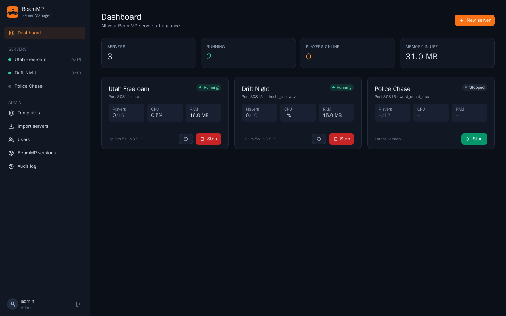
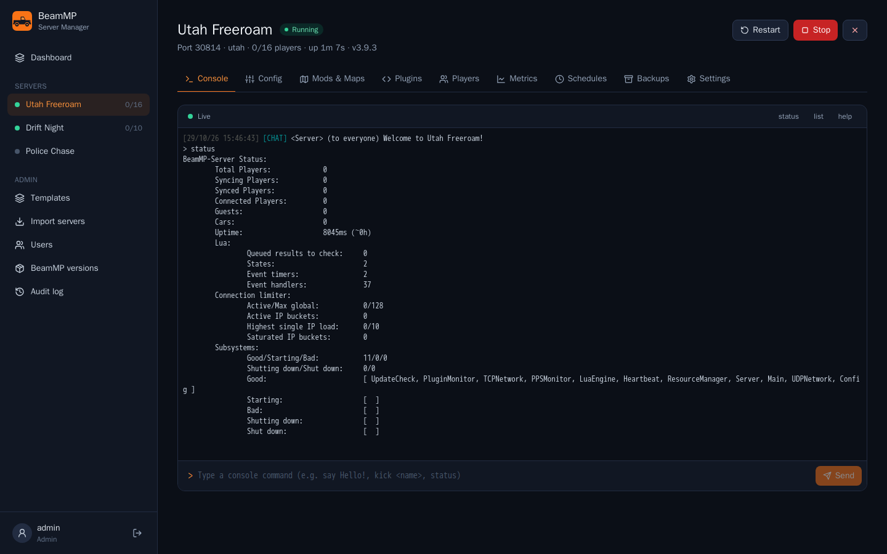
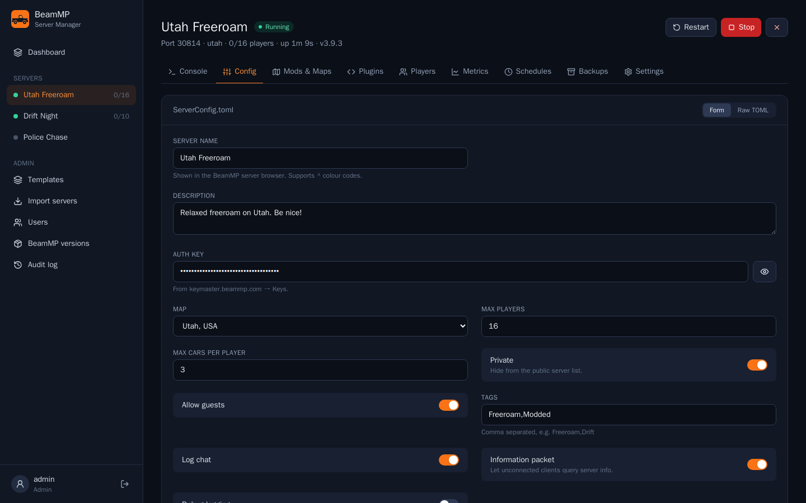
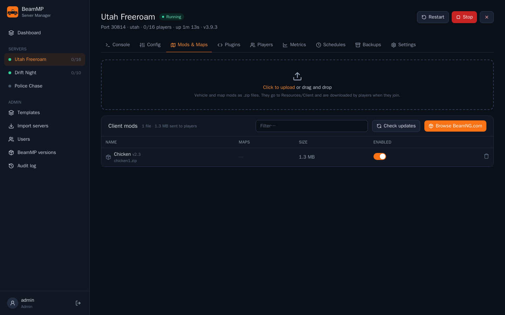
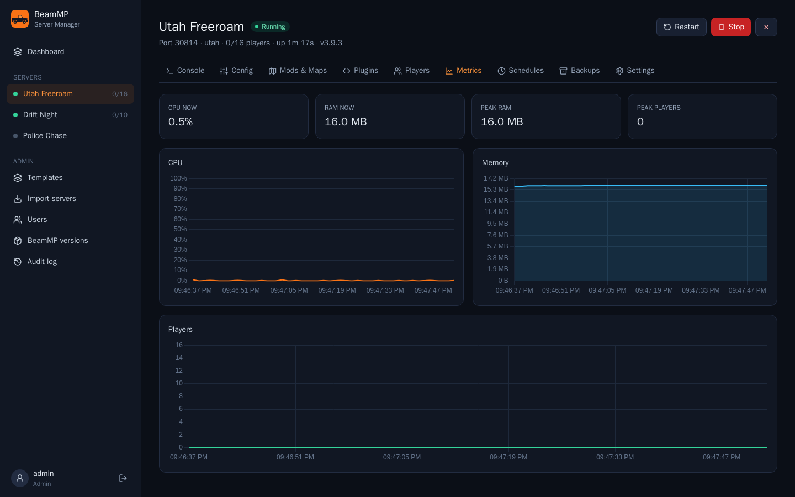
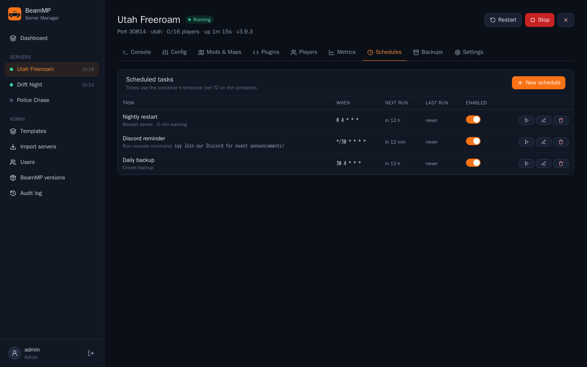
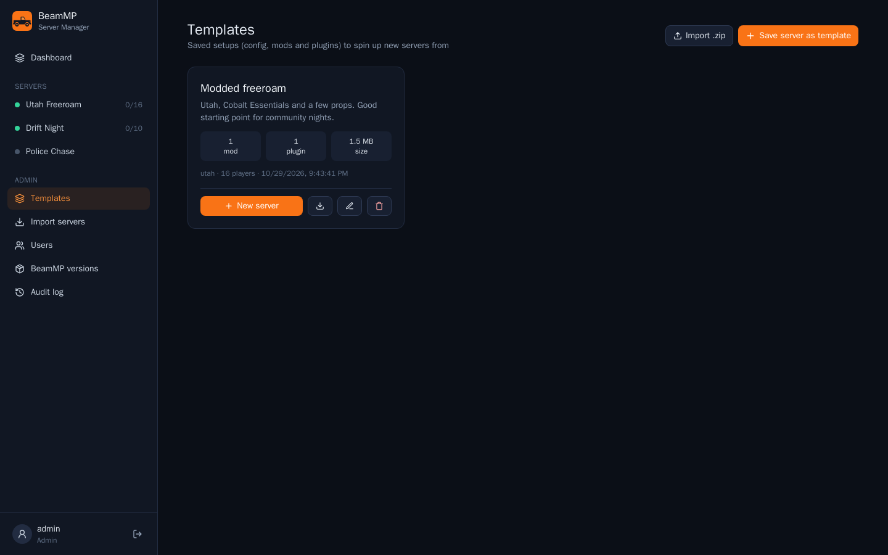

# BeamMP Server Manager

A self-hosted, Crafty-style web panel for [BeamMP](https://beammp.com) servers. Run any number of BeamMP servers in one Docker container and manage them from your browser.



| Live console | Config editor |
|---|---|
|  |  |
| **Mods & maps** | **Metrics** |
|  |  |
| **Scheduled tasks** | **Templates** |
|  |  |

## Features

- **Multiple servers.** Create, start, stop, restart and force-kill them. Each one has its own port, config, mods and plugins.
- **Live console.** Real-time output (xterm.js) with command input, history and quick commands.
- **Config editor.** A form for `ServerConfig.toml` with a map picker and a hidden auth key, plus a raw TOML editor. Comments in the file are kept.
- **Mods and maps.** Drag-and-drop `.zip` uploads, enable or disable mods, automatic detection of maps inside mod zips, and one-click "use this map".
- **Lua plugins.** Upload a `.zip` or a single `.lua` file, then enable, disable or delete plugins.
- **Players.** Live player list, kick, ban (by name, BeamMP ID or IP), chat log, and messaging all players as Server.
- **Metrics.** CPU, RAM and player-count graphs covering the last 30 minutes.
- **Schedules.** Cron jobs for restart, start, stop, backup, console commands, or update-and-restart, with an optional in-game countdown.
- **Backups.** One-click tar.gz backups with retention, download, and restore.
- **BeamMP versions.** Binaries are downloaded automatically from GitHub releases. Each server can follow "latest" or be pinned to a version.
- **Users.** Admin, operator and viewer roles with per-server access, plus an audit log.
- **Reliability.** Servers restart automatically after a crash (up to 3 times in 5 minutes) and can start when the container starts.
- **Mod browser.** Browse BeamNG.com by category and sort order, or paste a mod link, and install with one click. The panel remembers which version is installed and can check for updates. Keyword search isn't available because BeamNG.com puts it behind a bot check.
- **Plugin browser.** Featured plugins plus a GitHub search. The panel works out the repo layout itself: a `Resources/Server` zip, bare `.lua` files, or several plugin folders plus a client UI mod (as in BeamJoy).
- **Templates.** Save a server's config, mods and plugins as a template. You can create new servers from a template, clone a server, and export or import templates as `.zip` files.
- **Import.** Mount existing BeamMP server folders at `/import` (read-only). The panel finds them and copies in the config, mods and plugins, including ich777's `deactivated_mods` and `deactivated_plugins` folders.
- **Background jobs.** Large downloads and copies run in the background with a progress bar. Mod zips are hard-linked between servers and templates when they're on the same disk, so clones and templates take up almost no extra space.

## Quick start

```sh
docker compose up -d
```

The image is published as `ghcr.io/spencerpedia/beammp-server-manager` for amd64 and arm64. Use `:latest`, or pin a
release such as `:1.0.0`. To build it yourself instead, run `docker build -t beammp-server-manager .`.

Open `http://<host>:8000` and create the admin account. Then create a server and paste an Auth Key from
[keymaster.beammp.com](https://keymaster.beammp.com) → Keys.

### Ports

Each BeamMP server needs **one port, open on both TCP and UDP**. The container publishes `30814-30823` (10 servers) by default.
If you want a different range, change `GAME_PORT_RANGE` and the published ports together. To let players outside your network join, forward the same ports on your router.

### Unraid

Download the template onto the server, then add the container from **Docker → Add Container** and choose **BeamMP-Server-Manager**:

```sh
wget -O /boot/config/plugins/dockerMan/templates-user/my-BeamMP-Server-Manager.xml \
  https://raw.githubusercontent.com/spencerpedia/BeamMP-Server-Manager/main/unraid-template.xml
```

Updates appear in the Docker tab like any other container ("apply update").

### Environment variables

| Variable | Default | Purpose |
|---|---|---|
| `GAME_PORT_RANGE` | `30814-30823` | Ports the panel may assign to servers |
| `PUID` / `PGID` | `99` / `100` | Owner of the files in `/data` and `/backups` |
| `TZ` | `UTC` | Timezone used for schedules |
| `SECRET_KEY` | random, stored in `/data/secret.key` | Signs login sessions |
| `COOKIE_SECURE` | `false` | Set to `true` when the panel is served over HTTPS |
| `GITHUB_TOKEN` | — | Optional. Raises GitHub's rate limit for the plugin browser |
| `BEAMMP_ASSET` | `BeamMP-Server.debian.12.<arch>` | Which release binary to download |

### Volumes

- `/data`: the database (`manager.db`), `binaries/<version>/` and `servers/<id>/`. Each server folder is a normal BeamMP server directory.
- `/backups`: `<server id>/*.tar.gz`
- `/import` (optional, read-only): existing BeamMP server folders to import
- Templates are stored in `/data/templates/<id>/`.

## How it works

- The panel is a FastAPI app. Each BeamMP-Server runs as a child process, and the panel sends console commands through stdin and reads output from stdout.
- A small bridge Lua plugin (`Resources/Server/_BMSM`) is installed into every server. It reports joins, leaves, chat and player lists as `[BMSM]{json}` lines, and it enforces the panel's ban list (`.bmsm/bans.json`) in `onPlayerAuth`. These lines are kept out of the console view.
- Stopping a server sends `exit`, waits for a clean shutdown, and only then falls back to SIGTERM and SIGKILL.
- Child processes stop when the container stops, just like with Crafty. Turn on **Start with the panel** for servers that should come back up automatically.

## Development

```sh
# backend (Python 3.12)
cd backend && pip install -r requirements.txt pytest
DATA_DIR=../data BACKUP_DIR=../backups uvicorn app.main:app --reload
python -m pytest

# frontend (proxies /api and /ws to :8000)
cd frontend && npm install && npm run dev
```

## License

[MIT](LICENSE). BeamMP and BeamNG.drive are trademarks of their respective owners; this project is not affiliated with either.
